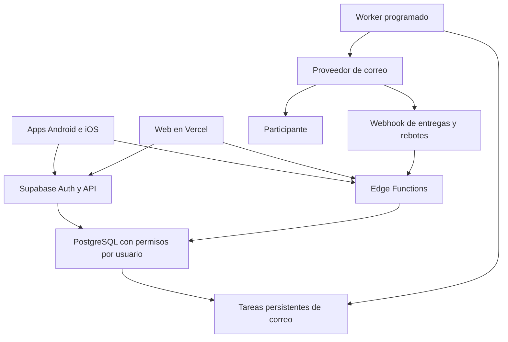

# Arquitectura propuesta

## Plataforma

Se propone React Native con Expo, Expo Router y TypeScript. Permite compartir lógica y buena parte de la interfaz entre Android, iOS y web, manteniendo adaptaciones para navegación, autenticación y compras de cada plataforma. Supabase publica una [guía de autenticación social con Expo](https://supabase.com/docs/guides/auth/quickstarts/with-expo-react-native-social-sign-in).

Se ha creado la primera base local en `app/` con Expo SDK 58 y su matriz de dependencias compatibles, fijadas mediante `package-lock.json`. El prototipo utiliza Expo Router y almacenamiento local. La elección sigue pendiente de validarse con Google, Apple, sesiones privadas y pruebas de interfaz en web y dispositivos.

| Componente | Propuesta y función |
| --- | --- |
| App universal | Expo, React Native, Expo Router y TypeScript |
| Datos | PostgreSQL de Supabase |
| Fotografías de deseos | Supabase Storage con acceso privado y autorización por participante |
| Identidad del organizador | Supabase Auth con Google; propuesta adicional de Apple para iOS |
| Operaciones sensibles | Supabase Edge Functions y funciones de base de datos con permisos restringidos |
| Entrega de correos | Proveedor transaccional por seleccionar; Resend es un candidato |
| Procesamiento de envíos | Bandeja persistente de tareas en PostgreSQL y worker programado |
| Web | Exportación web compatible con Vercel |
| Binarios móviles | Expo Build y Submit, con firma y cuentas de las tiendas |
| Compras | Facturación de cada tienda; evaluar RevenueCat para unificar validación |

## Vercel y distribución móvil

Vercel puede alojar la web exportada por Expo; su documentación incluye [configuración específica para Vercel](https://docs.expo.dev/guides/publishing-websites/#vercel). Se propone inicialmente una SPA con `web.output: "single"`, evitando necesitar un servidor web adicional para las operaciones de negocio. Antes del despliegue se configurarán rutas profundas y archivos de asociación de enlaces de iOS y Android, que deben servirse como archivos reales.

La distribución móvil requiere binarios firmados y envío a las tiendas; [Expo Submit](https://docs.expo.dev/deploy/submit-to-app-stores/) permite realizar el proceso desde Windows mediante sus servicios. La revisión y salida a producción siguen dependiendo de cada tienda.

## Comunicación entre componentes

El navegador o la app pueden usar consultas protegidas por RLS para datos autorizados. Generar el sorteo, reclamar una identidad de invitado, enviar correos y validar compras siempre requieren autorización del servidor.

## Generación del sorteo

Modelar participantes como dos conjuntos: quienes regalan y quienes reciben. Cada relación permitida es una arista; resolver un emparejamiento perfecto. Las autoasignaciones y excepciones se eliminan previamente.

Se propone un algoritmo de matching con orden aleatorio obtenido de un generador criptográfico. Debe encontrar una solución si existe dentro de los límites admitidos. Aleatorizar el recorrido no garantiza que todas las soluciones válidas tengan la misma probabilidad; no anunciar uniformidad matemática sin implementar y demostrar un muestreo adecuado.

La validación debe detectar restricciones globales incompatibles, incluso si cada persona tiene algún destinatario permitido. No usar intentos aleatorios limitados que puedan anunciar falsamente que el grupo es imposible. Distinguir un problema de recursos o tiempo de la inexistencia probada de solución.

### Guardado y concurrencia

1. Autenticar al organizador y verificar que el sorteo pertenece a su cuenta.
2. Obtener participantes y excepciones junto con la versión del borrador; calcular una solución en el servidor.
3. En una transacción, bloquear el sorteo, comprobar estado y versión y validar otra vez la solución completa.
4. Insertar todos los emparejamientos, una ejecución y las tareas de correo; cambiar a `drawn` y confirmar la transacción.
5. Si cambió el borrador, rechazar la solución obsoleta. Si ya existe una ejecución, devolver su estado sin generar otra.

Las modificaciones del borrador también deben respetar el bloqueo y la versión. Un índice único de ejecución por sorteo y una clave de idempotencia resuelven reintentos concurrentes. La función de confirmación no debe aceptar propuestas arbitrarias del cliente: solo el servicio autorizado puede invocarla.

## Correos fiables

Hay dos comunicaciones de negocio diferenciadas: invitación previa para acceder al grupo y rellenar deseos, y resultado después del sorteo. Cada tipo debe tener sus propias claves de idempotencia y plantillas. La copia de un sorteo no envía ninguna de ellas por sí sola.

La bandeja de salida persiste en la misma transacción que los resultados. El worker reclama tareas con un arrendamiento temporal, limita concurrencia y reintenta con esperas crecientes. Un fallo del proceso no pierde los correos pendientes.

Cada envío tiene una clave estable por ejecución, participante y tipo. Si el proveedor acepta claves de idempotencia, se reutiliza en reintentos dentro de sus garantías. Cuando una respuesta se pierde tras aceptar el correo, puede existir riesgo de duplicado; reconciliar antes de reintentar cuando sea posible. No prometer entrega exactamente una vez entre sistemas distintos.

El proveedor distingue aceptación, entrega, rebote y queja mediante webhooks autenticados y deduplicados. No mostrar «entregado» solo porque una llamada HTTP terminó bien. Los reenvíos manuales se limitan y auditan.

Supabase ofrece [integraciones de correo desde Edge Functions](https://supabase.com/docs/guides/functions/examples/send-emails). Los resultados del sorteo son correos de negocio, separados de los de autenticación. Para verificaciones de acceso basadas en Supabase Auth, configurar [SMTP de producción](https://supabase.com/docs/guides/auth/auth-smtp); su servicio por defecto no sirve como sistema público de entrega.

## Alternativas consideradas

| Alternativa | Evaluación inicial |
| --- | --- |
| Flutter y Supabase | Viable, con ecosistema y lenguaje diferentes; no aporta una ventaja clara para este equipo todavía |
| Next.js y Capacitor | Prioriza reutilización web; exige validar experiencia móvil y adaptadores nativos |
| Apps nativas separadas | Mayor control, con mayor esfuerzo para mantener tres interfaces |
| Expo Hosting | Alternativa a Vercel si se requieren capacidades web de servidor específicas de Expo |

## Organización futura del código

La duplicación crea un borrador con IDs nuevos y copia la configuración, remapeando participantes y excepciones en una transacción. Nunca copia ejecuciones o credenciales de acceso. Los cambios de deseos se guardan separados de los datos que determinan los emparejamientos.

El derecho de uso de listas pertenece a la cuenta del organizador mediante compra permanente, no a la ejecución del sorteo. El servidor lo comprueba al habilitar la función y autorizar las operaciones correspondientes; la política tras un reembolso está pendiente.

La app universal está en `app/`, con rutas en `src/app/`, componentes en `src/components/`, dominio en `src/domain/` y datos locales de ejemplo en `src/data/`. La futura carpeta `supabase/` contendrá migraciones y funciones cuando se integre el backend. No se ha introducido un monorepo ni un segundo frontend web.
